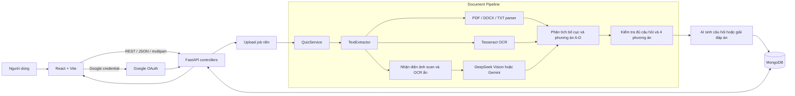

# AIQuiz

> Biến tài liệu học tập thành bài trắc nghiệm trực tuyến với sự hỗ trợ của AI.

🌐 **Trải nghiệm ứng dụng:** [https://ai-quiz-blush.vercel.app](https://ai-quiz-blush.vercel.app)

## Giới thiệu

AIQuiz là nền tảng học tập và chia sẻ tài nguyên trắc nghiệm thông minh. Thay vì nhập thủ công từng câu hỏi, người dùng chỉ cần tải lên tài liệu PDF, DOCX hoặc TXT. Hệ thống sẽ đọc nội dung, nhận diện câu hỏi và các phương án A–D, sau đó tạo thành một bài quiz có thể làm ngay trên trình duyệt.

AIQuiz được xây dựng hướng đến tài liệu tiếng Việt, đặc biệt là các đề thi scan có bố cục phức tạp như đáp án trình bày theo hai cột, nội dung xuống nhiều dòng, chữ viết tay chồng lên văn bản hoặc lớp OCR có sẵn bị sai.

## Tổng quan dự án

AIQuiz cung cấp hai cách tạo bài trắc nghiệm:

- **Trích xuất đề có sẵn:** giữ lại câu hỏi và phương án trong tài liệu gốc, phù hợp khi số hóa đề thi.
- **Sinh câu hỏi bằng AI:** phân tích nội dung bài học và tự động tạo bộ câu hỏi mới để ôn tập.

Sau khi xử lý tài liệu, người dùng có thể làm bài, kiểm tra từng câu, nộp bài để chấm điểm và xem lại lịch sử. Các quiz công khai được hiển thị trong kho tài nguyên cộng đồng và có thể lọc theo môn học hoặc kỳ thi.

## AIQuiz dành cho ai?

- **Học sinh, sinh viên:** chuyển giáo trình và đề cương thành quiz để tự ôn tập.
- **Giáo viên, giảng viên:** số hóa đề thi, tạo nhanh bộ câu hỏi và chia sẻ tài nguyên.
- **Người tự học:** luyện tập kiến thức từ tài liệu cá nhân mà không phải nhập câu hỏi thủ công.
- **Nhóm học tập:** xây dựng kho đề chung và làm bài trực tiếp trên nhiều thiết bị.

## Cách sử dụng

1. Đăng nhập bằng tài khoản Google hoặc truy cập kho quiz công khai.
2. Chọn **Upload tài liệu** để trích xuất đề có sẵn, hoặc **Sinh câu hỏi bằng AI** để tạo bài tập mới.
3. Tải lên một file PDF, DOCX hoặc TXT và điền thông tin môn học, kỳ thi nếu cần.
4. Theo dõi tiến trình đọc tài liệu, OCR và tạo quiz.
5. Kiểm tra nội dung được nhận diện, bắt đầu làm bài và nộp bài để xem kết quả.

## Các màn hình chính

| Màn hình | Chức năng |
|---|---|
| Trang chủ | Xem kho quiz cộng đồng và lọc theo môn học, kỳ thi |
| Upload tài liệu | Trích xuất câu hỏi trắc nghiệm có sẵn từ tài liệu |
| Sinh câu hỏi | Dùng AI tạo bài trắc nghiệm mới từ nội dung học tập |
| Làm bài | Chọn đáp án, kiểm tra từng câu và chuyển giữa các câu hỏi |
| Kết quả | Xem điểm số, số câu đúng/sai và đáp án |
| Lịch sử | Xem lại các lần làm bài trước đây |

## Tính năng chính

- Tạo câu hỏi mới từ nội dung tài liệu (`generate`).
- Trích xuất câu hỏi có sẵn trong đề thi (`extract`).
- Hỗ trợ PDF, DOCX và TXT, tối đa 50 MB.
- OCR tiếng Việt/Anh bằng Tesseract tích hợp qua PyMuPDF.
- Đọc PDF scan bằng DeepSeek Vision hoặc Gemini, có thể cấu hình độc lập với model sinh đáp án.
- Nhận diện lớp OCR ẩn bị lỗi và đọc lại từ ảnh gốc.
- Xử lý phương án A–D theo một cột hoặc bảng 2 × 2, kể cả khi nội dung xuống nhiều dòng.
- Đọc lại các câu thiếu phương án; câu vẫn chưa đủ A–D được bỏ riêng thay vì làm hỏng toàn bộ quiz.
- Đăng nhập Google, xác thực JWT và chế độ đăng nhập giả lập khi phát triển.
- Danh sách quiz công khai, bộ lọc môn học/ngành/kỳ thi/trường.
- Làm bài, kiểm tra từng đáp án, nộp bài, chấm điểm và xem lịch sử.
- Xử lý upload bất đồng bộ, frontend theo dõi tiến độ theo từng giai đoạn.

## Kiến trúc ứng dụng

### Luồng xử lý tài liệu

1. API kiểm tra định dạng, kích thước và tạo một upload job.
2. `TextExtractor` phân loại tài liệu thành text gốc, trang scan hoặc nội dung hỗn hợp.
3. Tài liệu có text được đọc trực tiếp; ảnh scan được xử lý bằng OCR cục bộ hoặc Vision AI.
4. Bộ đọc bố cục tách số câu, nội dung câu hỏi và các phương án A–D theo tọa độ/dòng.
5. Hệ thống kiểm tra chất lượng, đọc lại vùng lỗi và bỏ riêng câu vẫn thiếu phương án.
6. Chế độ `extract` giữ câu hỏi từ file; chế độ `generate` dùng AI tạo câu hỏi từ nội dung.
7. Quiz, câu hỏi, tài liệu và lịch sử làm bài được lưu trong MongoDB.

## Công nghệ sử dụng

| Thành phần | Công nghệ |
|---|---|
| Frontend | React 19, Vite, React Router, Zustand, Axios |
| Backend | Python, FastAPI, Pydantic, Uvicorn |
| Database | MongoDB, Motor/PyMongo |
| Xử lý tài liệu | PyMuPDF, python-docx, chardet |
| OCR | Tesseract qua PyMuPDF, `vie+eng` traineddata |
| AI | DeepSeek hoặc Google Gemini |
| Xác thực | Google OAuth 2.0, JWT |
| Triển khai | Vercel, Render |

---

🌐 **Bắt đầu sử dụng AIQuiz tại:** [ai-quiz-blush.vercel.app](https://ai-quiz-blush.vercel.app)

