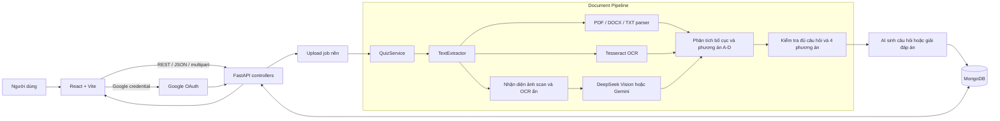

# AIQuiz

AIQuiz là ứng dụng web tạo và trích xuất bài trắc nghiệm từ tài liệu. Người dùng có thể tải lên PDF, DOCX hoặc TXT; hệ thống đọc nội dung, nhận diện đề scan, tách câu hỏi và phương án A–D, giải những câu chưa có đáp án rồi tạo thành quiz có thể làm trực tiếp trên trình duyệt.

Ứng dụng tập trung vào tài liệu tiếng Việt và các đề thi có bố cục phức tạp: phương án nằm trên một dòng, bảng 2 cột × 2 hàng, ảnh chụp nhiều trang, chữ viết tay chồng lên đáp án và PDF chứa lớp OCR cũ bị lỗi.

> Demo frontend: [ai-quiz-blush.vercel.app](https://ai-quiz-blush.vercel.app)

## Tính năng chính

- Tạo câu hỏi mới từ nội dung tài liệu (`generate`).
- Trích xuất câu hỏi có sẵn trong đề thi (`extract`).
- Hỗ trợ PDF, DOCX và TXT, tối đa 50 MB.
- OCR tiếng Việt/Anh bằng Tesseract tích hợp qua PyMuPDF.
- Đọc PDF scan bằng DeepSeek Vision hoặc Gemini, có thể cấu hình độc lập với model sinh đáp án.
- Nhận diện lớp OCR ẩn bị lỗi và đọc lại từ ảnh gốc.
- Xử lý phương án A–D theo một cột hoặc bảng 2 × 2, kể cả khi nội dung xuống nhiều dòng.
- Đọc lại các câu thiếu phương án; câu vẫn chưa đủ A–D được bỏ riêng thay vì làm hỏng toàn bộ quiz.
- Đăng nhập Google, xác thực JWT và chế độ đăng nhập giả lập khi phát triển.
- Danh sách quiz công khai, bộ lọc môn học/ngành/kỳ thi/trường.
- Làm bài, kiểm tra từng đáp án, nộp bài, chấm điểm và xem lịch sử.
- Xử lý upload bất đồng bộ, frontend theo dõi tiến độ theo từng giai đoạn.

## Kiến trúc ứng dụng



### Luồng xử lý tài liệu

1. API kiểm tra định dạng, kích thước và tạo một upload job.
2. `TextExtractor` phân loại tài liệu thành text gốc, trang scan hoặc nội dung hỗn hợp.
3. Tài liệu có text được đọc trực tiếp; ảnh scan được xử lý bằng OCR cục bộ hoặc Vision AI.
4. Bộ đọc bố cục tách số câu, nội dung câu hỏi và các phương án A–D theo tọa độ/dòng.
5. Hệ thống kiểm tra chất lượng, đọc lại vùng lỗi và bỏ riêng câu vẫn thiếu phương án.
6. Chế độ `extract` giữ câu hỏi từ file; chế độ `generate` dùng AI tạo câu hỏi từ nội dung.
7. Quiz, câu hỏi, tài liệu và lịch sử làm bài được lưu trong MongoDB.

## Công nghệ sử dụng

| Thành phần | Công nghệ |
|---|---|
| Frontend | React 19, Vite, React Router, Zustand, Axios |
| Backend | Python, FastAPI, Pydantic, Uvicorn |
| Database | MongoDB, Motor/PyMongo |
| Xử lý tài liệu | PyMuPDF, python-docx, chardet |
| OCR | Tesseract qua PyMuPDF, `vie+eng` traineddata |
| AI | DeepSeek hoặc Google Gemini |
| Xác thực | Google OAuth 2.0, JWT |
| Kiểm thử | Pytest, pytest-asyncio, Vitest, Testing Library |
| Triển khai | Vercel (frontend), backend tương thích Render/Uvicorn |

## Cấu trúc thư mục

```text
AIQuiz/
├── backend/
│   ├── app/
│   │   ├── controllers/       # REST API: auth, documents, quizzes
│   │   ├── models/            # Pydantic models
│   │   ├── repositories/      # Truy cập dữ liệu danh mục
│   │   ├── services/          # OCR, AI, đọc PDF, orchestration
│   │   ├── utils/             # Parser câu hỏi, kiểm tra chất lượng, text processing
│   │   ├── config.py          # Cấu hình từ biến môi trường
│   │   ├── database.py        # Kết nối MongoDB
│   │   └── main.py            # FastAPI entry point
│   ├── scripts/               # Tải tessdata, kiểm tra scan, import dữ liệu
│   ├── tests/                 # Backend test suite
│   ├── .env.example
│   └── requirements.txt
├── frontend/
│   ├── public/
│   ├── src/
│   │   ├── components/
│   │   ├── services/          # API client và upload polling
│   │   ├── store/             # Trạng thái đăng nhập
│   │   └── views/             # Trang chủ, upload, quiz, lịch sử
│   ├── package.json
│   └── vercel.json
└── README.md
```

## Yêu cầu hệ thống

- Python 3.11 trở lên.
- Node.js 20 trở lên và npm.
- MongoDB local hoặc MongoDB Atlas.
- API key DeepSeek hoặc Gemini nếu sử dụng AI/Vision OCR.

## Cài đặt và chạy local

### 1. Clone repository

```bash
git clone git@github.com:Lekingna16/AIQuiz.git
cd AIQuiz
```

### 2. Khởi động backend

Trên Windows PowerShell:

```powershell
cd backend
python -m venv .venv
.\.venv\Scripts\Activate.ps1
pip install -r requirements.txt
Copy-Item .env.example .env
python scripts/download_tessdata.py
uvicorn app.main:app --reload --port 8000
```

Trên macOS/Linux:

```bash
cd backend
python3 -m venv .venv
source .venv/bin/activate
pip install -r requirements.txt
cp .env.example .env
python scripts/download_tessdata.py
uvicorn app.main:app --reload --port 8000
```

Backend chạy tại `http://localhost:8000`. Tài liệu API:

- Swagger UI: `http://localhost:8000/docs`
- ReDoc: `http://localhost:8000/redoc`
- Health check: `http://localhost:8000/health`

### 3. Cấu hình backend

Chỉnh `backend/.env`:

```dotenv
DEBUG=true

MONGODB_URL=mongodb://localhost:27017
MONGODB_DB_NAME=aiquiz

AI_PROVIDER=deepseek
DEEPSEEK_API_KEY=your_deepseek_api_key
DEEPSEEK_MODEL=deepseek-flash
DEEPSEEK_VISION_MODEL=deepseek-flash

# Có thể dùng Gemini cho AI hoặc OCR
GEMINI_API_KEY=your_gemini_api_key
GEMINI_MODEL=your_gemini_model

OCR_ENABLED=true
OCR_LANGUAGES=vie+eng
OCR_DPI=250
OCR_MAX_PAGES=24
OCR_PROVIDER=deepseek
OCR_AI_VISION=true
EXTRACT_AI_FALLBACK=true

GOOGLE_CLIENT_ID=your_google_client_id
JWT_SECRET_KEY=replace_with_a_long_random_secret
FRONTEND_URL=http://localhost:5173
```

`AI_PROVIDER` điều khiển model sinh/giải câu hỏi. `OCR_PROVIDER` điều khiển model đọc ảnh scan; hai giá trị có thể cấu hình độc lập thành `deepseek` hoặc `gemini`.

### 4. Khởi động frontend

Mở terminal mới:

```bash
cd frontend
npm ci
```

Tạo `frontend/.env.local`:

```dotenv
VITE_API_URL=http://localhost:8000
VITE_GOOGLE_CLIENT_ID=your_google_client_id
```

Sau đó chạy:

```bash
npm run dev
```

Frontend chạy tại `http://localhost:5173`.

## API chính

| Method | Endpoint | Mô tả |
|---|---|---|
| `POST` | `/api/documents/upload` | Upload tài liệu và tạo job xử lý |
| `GET` | `/api/documents/jobs/{job_id}` | Theo dõi trạng thái upload/OCR |
| `GET` | `/api/documents/me` | Danh sách tài liệu của người dùng |
| `DELETE` | `/api/documents/{document_id}` | Xóa tài liệu và các quiz liên quan |
| `GET` | `/api/quizzes` | Danh sách quiz công khai |
| `GET` | `/api/quizzes/filters` | Dữ liệu bộ lọc và danh mục |
| `GET` | `/api/quizzes/{quiz_id}` | Chi tiết quiz để làm bài |
| `POST` | `/api/quizzes/{quiz_id}/questions/{question_id}/check` | Kiểm tra một đáp án |
| `POST` | `/api/quizzes/{quiz_id}/submit` | Nộp bài và chấm điểm |
| `GET` | `/api/quizzes/attempts/me` | Lịch sử làm bài |
| `POST` | `/api/auth/google` | Đăng nhập bằng Google |
| `GET` | `/api/auth/me` | Thông tin người dùng hiện tại |

## Kiểm thử

Backend:

```bash
cd backend
python -m pytest
```

Frontend:

```bash
cd frontend
npm test
npm run lint
npm run build
```

## Triển khai

### Backend

Thiết lập các biến trong `backend/.env.example` trên nền tảng triển khai. Build command tham khảo:

```bash
pip install -r requirements.txt && python scripts/download_tessdata.py
```

Start command:

```bash
uvicorn app.main:app --host 0.0.0.0 --port $PORT
```

### Frontend

Đặt thư mục root là `frontend`, khai báo `VITE_API_URL` và `VITE_GOOGLE_CLIENT_ID`, sau đó dùng:

```bash
npm ci && npm run build
```

Thư mục output là `frontend/dist`. File `vercel.json` đã cấu hình rewrite cho React Router.

## Lưu ý về OCR và quyền riêng tư

- Chất lượng nhận diện phụ thuộc độ nét, góc chụp, độ tương phản và mức độ chữ viết tay che nội dung.
- Khi `OCR_AI_VISION=true`, ảnh từ trang scan có thể được gửi tới nhà cung cấp được chọn trong `OCR_PROVIDER`. Chỉ bật tính năng này khi phù hợp với yêu cầu bảo mật của dữ liệu.
- Hệ thống không tự phát minh phần chữ bị che hoàn toàn. Câu vẫn thiếu một trong bốn phương án sau khi đọc lại sẽ được bỏ riêng và ghi nhận trong mô tả quiz.
- Không commit file `.env`, API key, JWT secret hoặc thông tin kết nối MongoDB lên GitHub.

## Đóng góp

1. Fork repository và tạo branch cho thay đổi.
2. Viết hoặc cập nhật test cho hành vi mới.
3. Chạy test backend/frontend và kiểm tra build.
4. Mở pull request, mô tả rõ lỗi, cách tái hiện và kết quả sau khi sửa.

